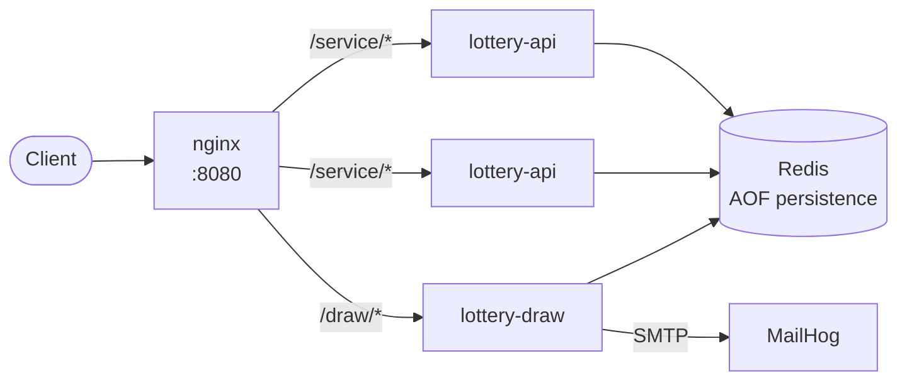
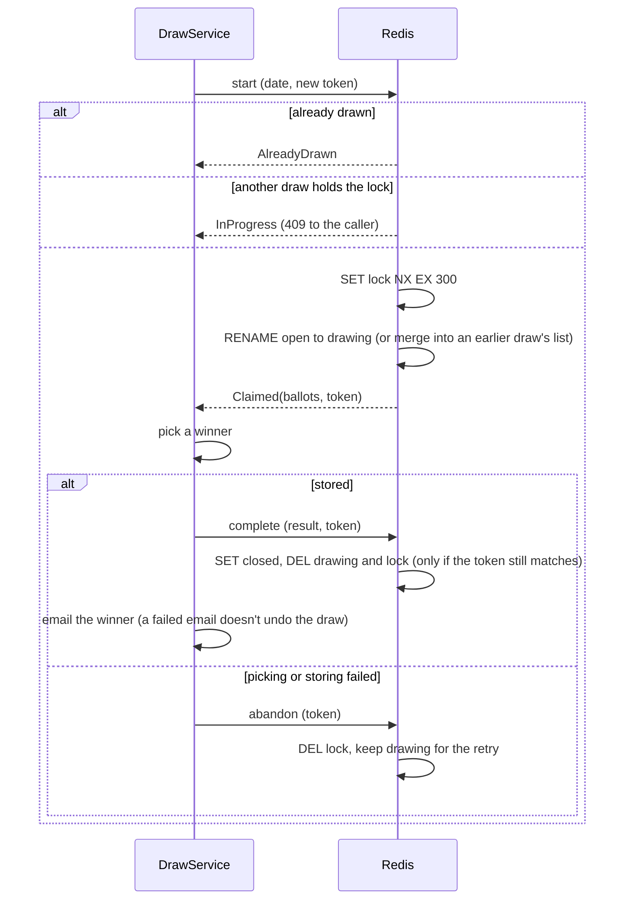

# Architecture

The lottery is two small services that share a Redis database, behind an nginx gateway.

- **lottery-api** registers participants and takes ballots. It holds no state of its own, so it scales horizontally (`docker-compose up --scale lottery-api=3`), and nginx balances requests across the instances.
- **lottery-draw** draws a winner every night and emails them. It also has a developer endpoint for drawing on demand, protected by an API secret.
- **Redis** holds everything. Every operation that has to be atomic is a single Redis command or Lua script, so any number of API instances and draws can run at once safely.

## Modules

| Module | Contents |
|---|---|
| `core` | Domain model, JSON codecs, validation, the Redis repositories, HTTP helpers and the API-secret middleware |
| `lottery-api` | Routes and `LotteryService`: registration and ballots |
| `lottery-draw` | Routes, `DrawService` (the draw itself), `DrawWorker` and `DrawSchedule` (the nightly schedule) and the email client |

Everything is written against `F[_]` with Cats Effect type classes. Time comes from `Clock` and ids from `UUIDGen`, so tests can run on a simulated clock with predictable ids.

## Data in Redis

| Key | Type | Holds |
|---|---|---|
| `participant:<sha256(email)>` | string | A participant as JSON. The key is a hash, so email addresses don't appear in key listings |
| `lottery:open:<date>` | list | Ballots submitted for that day's lottery |
| `lottery:drawing:<date>` | list | Ballots claimed by a draw that is running |
| `lottery:lock:<date>` | string, expires after 5 minutes | Marks a draw in progress, holding that draw's token |
| `lottery:closed:<date>` | string | The result, once the lottery has been drawn |

## The draw

A draw has to pick from every ballot submitted before it, and lose none submitted around it. It also mustn't run twice for the same day, even when the nightly draw and a manual one start at the same moment. Each step is one Lua script, which Redis runs atomically:

Submitting ballots is a script too: it refuses ballots while the lock or the result exists. So every accepted ballot either takes part in the draw, or is refused with a `409 Conflict` that the caller sees. None is accepted and then lost.

The lock expires after 5 minutes. If a draw service crashes mid-draw, a later draw can take over, and it merges the claimed ballots with any submitted since.

## The schedule

`DrawSchedule.nextRun` is a pure function: the next draw is today at `DRAW_TIME` if that's still ahead, otherwise tomorrow, in the `TIME_ZONE`. The worker calls it again after every draw, so the draw stays at the same local time across daylight-saving changes. `DAY_OFFSET` only picks which lottery a run draws, the run's date minus that many days, so `1` draws yesterday's lottery just after midnight. A failed draw is logged and the schedule carries on; the developer endpoint can redo it.

The API decides which day is "today", for refusing ballots for past dates, in the same `TIME_ZONE`. Ballots therefore can't land in a lottery that has already been drawn.

## Design decisions and limits

- **Redis as the only store** keeps the services simple and stateless. Lua scripts give atomic multi-key updates without a separate transaction or locking service.
- **One winner per day, picked uniformly from ballots**, so each ballot has the same chance and a participant's chance grows with their number of ballots. A statistical test checks this: 3 ballots out of 4 win about 75% of draws.
- **The draw service runs as a single instance**, which the schedule assumes. The draw protocol still makes a second instance, or a manual draw, safe: it gets `InProgress` instead of drawing twice.
- **Ballot ids are random UUIDs.** Participants are identified by email, compared trimmed and in lower case.
